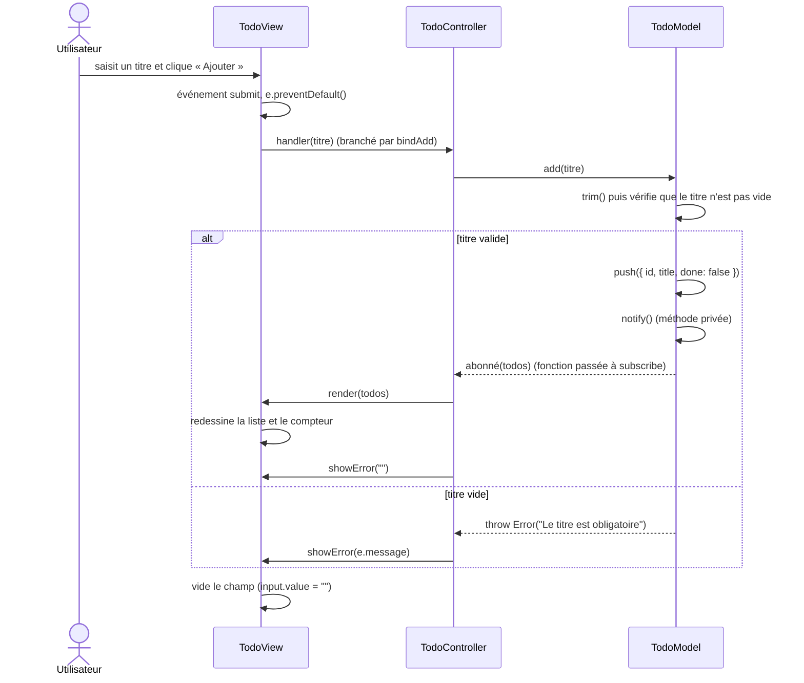
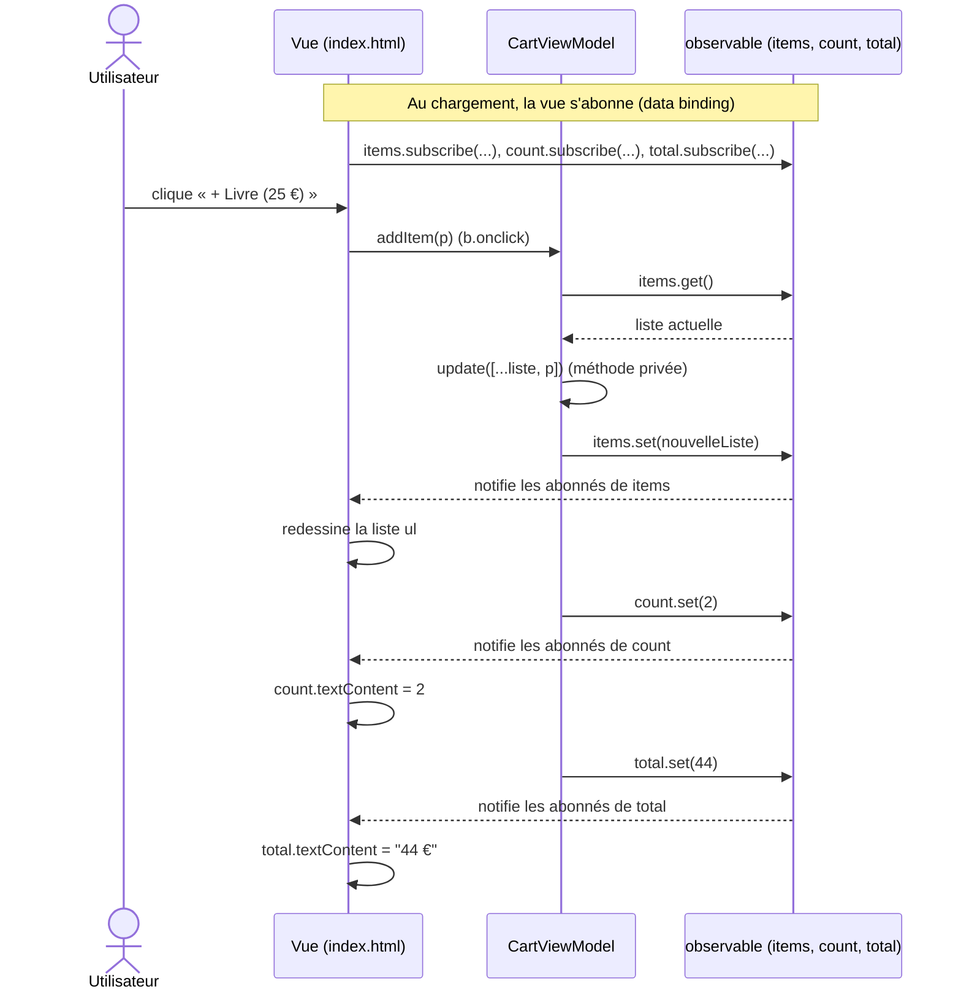

# ÉTAPE 1

# QUESTION 1: Quel fichier reçoit le clic de l'utilisateur ?
    - MVC: TodoView.js
    - MVP: index.html
    - MVVM: index.html

# QUESTION 2: Quel fichier contient la règle de validation ?
    - MVC: TodoModel.js
    - MVP: LoginPresenter.js
    - MVVM: CartViewModel.js

# QUESTION 3: Qui met l'écran à jour, et comment ?
    - MVC: C'est la Vue. Elle observe le Modèle (le Controller branche la Vue sur le Modèle) pour se mettre à jour
    - MVP: C'est le Presenter. Il le fait par des appels explicites (il commande la Vue)
    - MVVM: C'est la Vue, elle se met à jour toute seule grâce au data binding

# QUESTION 4: Combien de tests ? Ont-ils besoin du navigateur ?
    - MVC: Il possède 3 tests
    - MVP: Il possède 3 tests
    - MVVM: Il possède 2 tests

    - Non ces tests n'ont pas besoin d'un navigateur

# ÉTAPE 2: 

- Diagramme MVC

- Diagramme MVVM

# ÉTAPE 3

    - Le message s'affiche sans toucher à la View ni au Controller parce que la règle lève une exception dans TodoModel.add(), que le Controller attrape déjà dans son try/catch pour transmettre e.message à view.showError(), quel que soit le message.